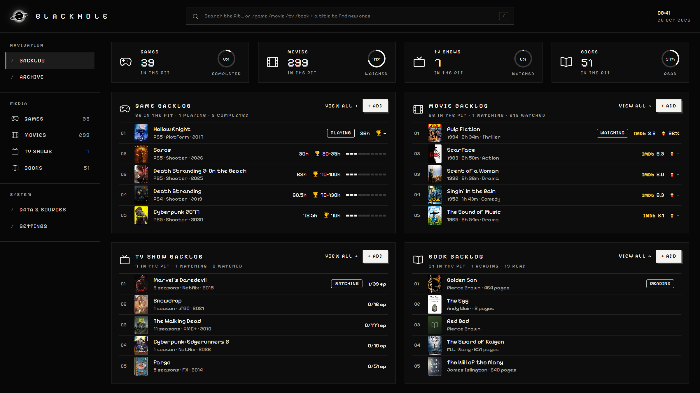
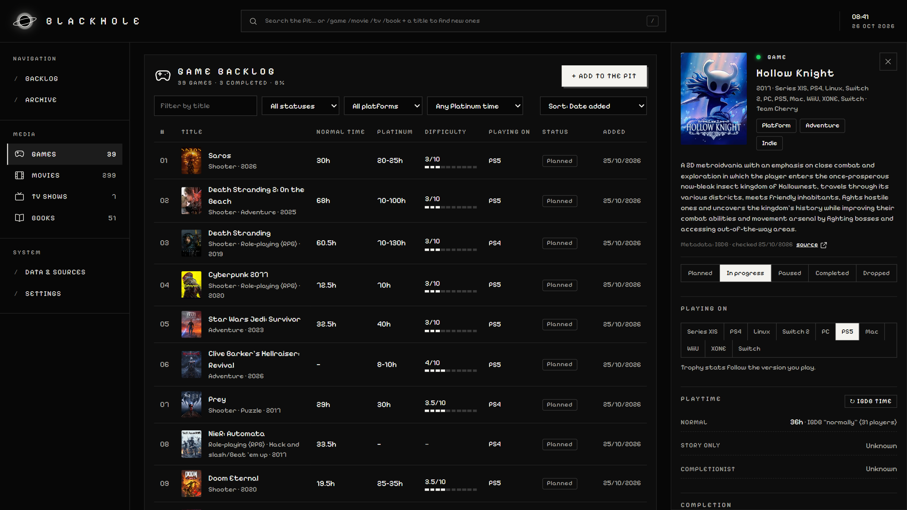
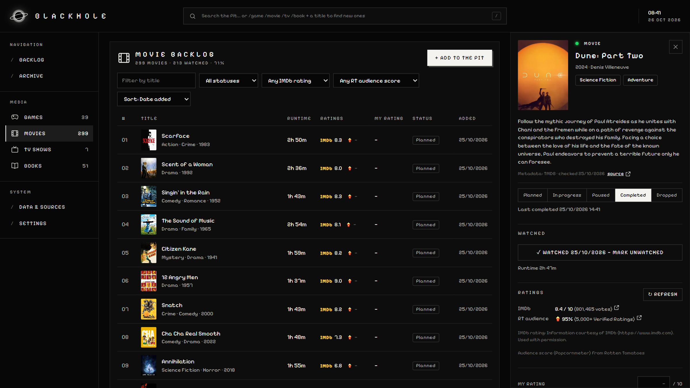
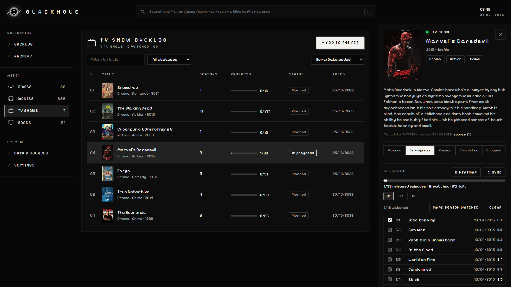
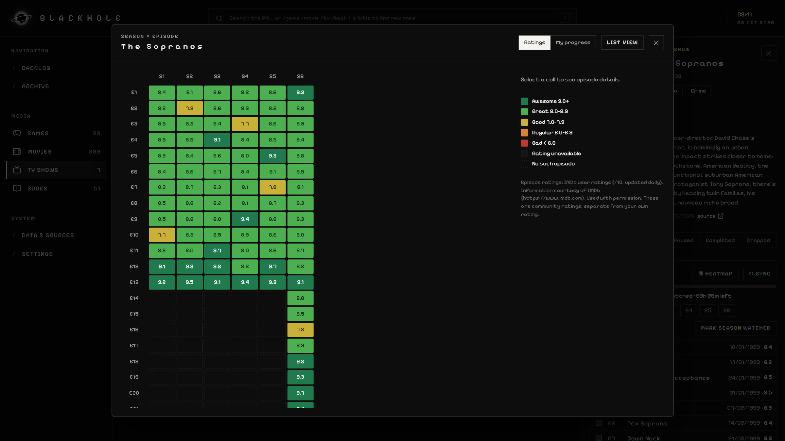
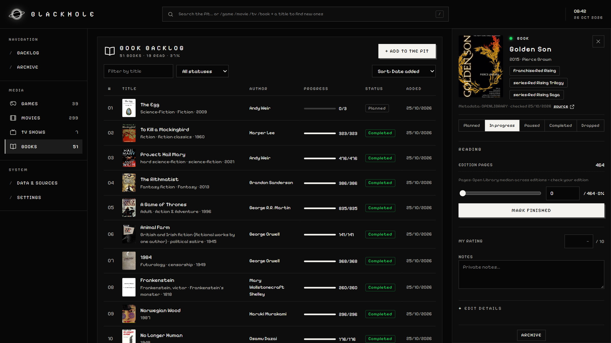
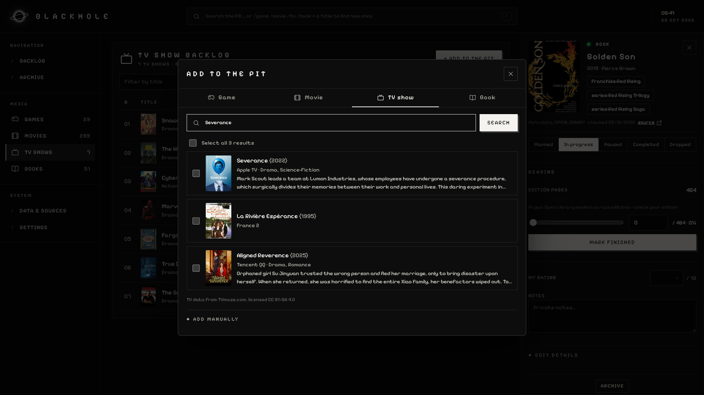
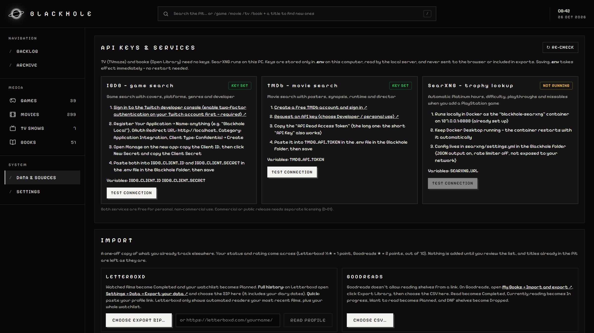

# Blackhole

Local-first personal backlog for **games, movies, TV and books**. It runs entirely on your own computer: a small Node server plus a web UI at http://127.0.0.1:4317. Nothing is uploaded anywhere; the only outside traffic is the provider lookups you trigger (TVmaze, IMDb datasets, Rotten Tomatoes, TMDb, IGDB, Open Library).

Specs: `BLACKHOLE_BRD.md`, `BLACKHOLE_PRD.md`, `BLACKHOLE_THREE_AGENT_CONSOLIDATED_RESEARCH.md`. Owner decisions: `docs/decisions/OPEN_QUESTIONS.md`.

## Screenshots



| | |
|---|---|
|  **Games**: normal time, Platinum hours and difficulty, the platform you play on |  **Movies**: runtime, IMDb rating and RT audience score |
|  **TV**: per-episode watch tracking by season |  **TV ratings heatmap**: IMDb rating for every episode |
|  **Books**: page progress against your edition |  **Add to the Pit**: search a provider and pick results |



> **Using an AI coding agent (Claude Code etc.)?** Point it at this folder and say *"set this project up"*. `CLAUDE.md` tells it how.

## Setup on a new computer

You get a clean copy: no API keys, no library data. Your own library starts empty.

### 1. Install Node.js

Node **22.13 or newer** (it uses the built-in `node:sqlite`; developed on Node 24). Download the LTS version from https://nodejs.org. Check with `node -v`.

### 2. Get the code

Either `git clone <repo url>`, or download the ZIP (GitHub → **Code → Download ZIP**) and unzip it anywhere.

### 3. Install and check

In a terminal, in the project folder:

```sh
npm install
npm test        # should report all tests passing
```

If npm prints a notice about install scripts, you can ignore it; nothing needs approving.

### 4. Start it

```sh
npm start       # builds the UI, then serves everything at http://127.0.0.1:4317
```

Open http://127.0.0.1:4317. Stop it with Ctrl+C. Next time, `npm run serve` starts it without rebuilding.

### 5. What works straight away, and what needs keys

| Feature | Needs |
|---|---|
| TV shows (search, episodes, watch tracking, IMDb ratings heatmap) | nothing |
| Books (Open Library) | nothing |
| Movie ratings: Rotten Tomatoes audience score | nothing |
| Movie ratings: IMDb | the TMDb key (TMDb supplies the movie's IMDb ID) |
| **Movie search** (TMDb) | a free TMDb key: **`TMDB_API_TOKEN`** |
| **Game search + playtime** (IGDB) | a free Twitch developer app: **`IGDB_CLIENT_ID`** + **`IGDB_CLIENT_SECRET`** |
| Automatic PlayStation trophy lookups | Docker + a local SearXNG (step 7) |

Without keys you can still add movies and games manually.

### 6. Add your API keys (optional)

Copy `config.example.env` to a new file named `.env` in the same folder, then fill in:

- **TMDb**: make a free account at https://www.themoviedb.org/signup → request an API key at https://www.themoviedb.org/settings/api (Developer / personal use) → copy the **API Read Access Token** (the long one) into `TMDB_API_TOKEN=`.
- **IGDB**: turn on two-factor authentication on a Twitch account (required), then at https://dev.twitch.tv/console/apps → **Register Your Application** (name: anything, OAuth Redirect URL: `http://localhost`, Category: *Application Integration*, Client Type: *Confidential*) → **Manage** → copy the **Client ID**, click **New Secret** and copy the **Client Secret** into `IGDB_CLIENT_ID=` and `IGDB_CLIENT_SECRET=`.

The same steps are shown in the app under **Data & Sources → API keys**.

The running server picks up `.env` changes without a restart. In the app, **Data & Sources → API keys → Test connection** confirms each key works. Use your own keys: they're tied to your account and must never be shared or committed (`.env` is git-ignored).

### 7. Trophy lookups with SearXNG (optional)

Needs [Docker Desktop](https://www.docker.com/products/docker-desktop/) running.

1. Copy `searxng/settings.example.yml` to `searxng/settings.yml` and replace `CHANGE_ME` with a long random string (e.g. the output of `node -e "console.log(crypto.randomBytes(32).toString('hex'))"`).
2. Start the container, using the absolute path to this project's `searxng` folder:

   ```sh
   docker run -d --name blackhole-searxng --restart unless-stopped -p 127.0.0.1:8888:8080 \
     -v "<full path to Blackhole>/searxng:/etc/searxng" searxng/searxng:latest
   ```

3. Data & Sources should now show SearXNG as enabled.

### 8. Desktop shortcut (Windows, optional)

Create a shortcut to `scripts\launch-blackhole.vbs` (right-click it → *Send to → Desktop*). Optionally set its icon to `assets\blackhole.ico`. Double-clicking it starts Docker/SearXNG if present, starts the server if it isn't running (logs in `data\logs\`), and opens Blackhole as an app window. The server keeps running after the window closes; stop it with `powershell -ExecutionPolicy Bypass -File scripts\stop-blackhole.ps1`.

## Where your data lives

- Library: `data/blackhole.sqlite`. Backups (Data & Sources → Backup): `data/backups/`. IMDb dataset cache (~64 MB, refreshed daily): `data/imdb/`.
- All of `data/`, `.env` and `searxng/settings.yml` are git-ignored. **Don't share them.** To give someone the project, share the repository or a GitHub ZIP, not a zip of your own folder.
- To move your library to another computer, copy `data/blackhole.sqlite` (with the server stopped).

## Commands

```sh
npm start            # build UI + serve at http://127.0.0.1:4317
npm run serve        # serve the existing build without rebuilding
npm run dev          # hot reload: API on 4317, UI on http://localhost:5173
npm test             # API/integration tests (in-memory DB, no network)
npm run typecheck
```

Optional `.env` settings (see `config.example.env`): `PORT`, `DATA_DIR`, `DATABASE_PATH`, `LOG_LEVEL`. The server refuses to bind anything other than loopback (D-01).

## What works (v0.1.0)

| Area | Status |
|---|---|
| Library CRUD for all four types, archive/restore, permanent delete (archive first + type the title) | ✅ |
| Status lifecycle, completion timestamps, event history, undo of the latest change | ✅ |
| Games: separate Story / Main+Extras / Completionist hours with sources; PS trophy stacks per platform/region (hours range, difficulty /10 + wording, playthroughs, online, missables, guide link); Story Completed and Platinum Earned tracked independently; Platinum N/A for non-PS games | ✅ manual |
| Trophy lookup via local SearXNG (D-02): auto-fills Platinum hours/difficulty/playthroughs/online/missables for the version you play when a PS game is added; `Refresh Trophy Data` shows a diff to apply; revert; source link + excerpt | ✅ needs Docker (container `blackhole-searxng`) |
| Playing on (D-05): pick PS5/PS4/etc. per game; trophies follow it | ✅ |
| IGDB normal time-to-beat (D-07) | ✅ with IGDB keys |
| TV: TVmaze search + season/episode import, per-episode watched toggles (out of order), bulk season/series with confirm + undo, unaired episodes blocked, specials excluded, runtime totals (labelled estimated when averaged), series auto-completes when all aired episodes are watched and reopens when new ones air (D-04) | ✅ |
| TV ratings heatmap: S×E grid, documented legend, Ratings / My progress modes, keyboard arrows, list fallback, episode drill-down | ✅ IMDb ratings only (official datasets); none shown when IMDb has none (D-03) |
| Movies: TMDb search with runtime/director enrichment, Mark Watched, personal rating; IMDb rating + Rotten Tomatoes audience score in the Add dialog, lists and inspector; filter/sort by either (D-09) | ✅ search needs TMDb key |
| Books: Open Library search, edition page count (labelled when it's a work median), page slider, Mark Finished | ✅ |
| Backup (SQLite snapshot) and JSON export | ✅ (restore UI not built) |
| Security: loopback-only, Host allowlist (DNS rebinding), Origin + `X-Blackhole` header on mutations (CSRF), CSP, zod validation, parameterised SQL, provider hosts allowlisted, provider HTML stripped to text | ✅ |

Not built yet: book series, release calendar, restore preview, CI/branch protection, Playwright E2E.

## Data sources and attribution

TV data from TVmaze.com (CC BY-SA 4.0). Information courtesy of IMDb (https://www.imdb.com), used with permission, from IMDb's non-commercial datasets for personal use. Rotten Tomatoes audience scores are read from the movie's public page at low volume (robots.txt honoured). This product uses the TMDB API but is not endorsed or certified by TMDB. Game data from IGDB. Book data from Open Library.
